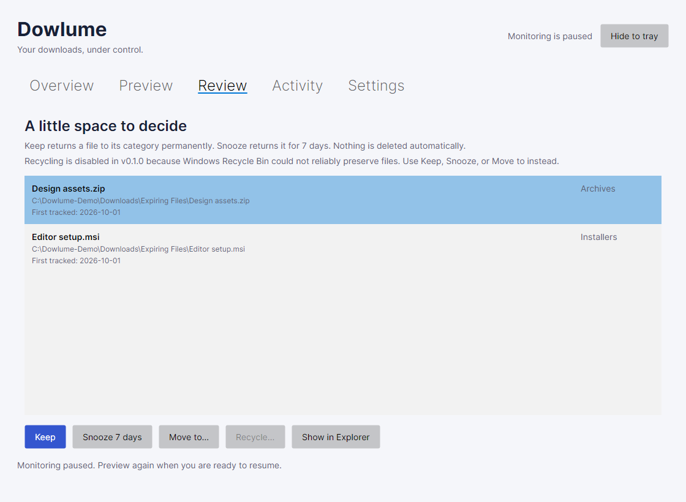

# Using Dowlume

Dowlume is a Windows desktop download organizer. Version 0.1.0 is currently a release candidate; public release packages are pending. Start with a disposable folder containing copies of sample files before choosing your real Downloads folder.

## Install and start

When a release package is available, download the installer or portable ZIP from [GitHub Releases](https://github.com/mglezz/dowlume/releases). Until then, Dowlume can be [built and run from source](../GETTING_STARTED.md).

For a downloaded or locally built package, run the setup executable (for example, `Dowlume-0.1.0-win-x64-setup.exe`). Installation is per user and does not require administrator privileges. Alternatively, extract the complete portable ZIP and run `Dowlume.App.exe`; do not move the executable out of its accompanying files. The .NET runtime is included.

Current locally built packages are unsigned; release signing is still a publication decision. Only use a package from a source you trust and compare its SHA-256 checksum with the accompanying `SHA256SUMS.txt`.

The package includes `START-HERE.txt`, which opens offline in a text editor. The installer adds a **Dowlume quick start** Start menu shortcut. Exit Dowlume, including any instance hidden in the tray, before upgrading or uninstalling; Setup refuses while the app is running. Installation and uninstall retain your files and local profile.

## First use

1. Open **Settings** and choose an existing local Downloads folder. The suggested path comes from the Windows Downloads known folder.
2. Adjust category folder names, extension mappings, excluded extensions, and review periods. Save settings.
3. Open **Preview** and select **Refresh preview**. This step does not move files or create category folders.
4. Review the proposed destinations, then select **Organize and monitor** and confirm. Consent covers previewed files, future arrivals, and unfinished files when they become ready.
5. Check **Overview** and **Activity** to see what happened.

*Preview shows the destination before you consent. All screenshots use the real views with fictional demonstration data; [capture details](images/README.md).*

*Overview brings together category counts, tracked files, and items that need your attention.*

Only files directly inside the selected folder are discovered. Existing subfolders are not imported or rearranged. Category folders and `Expiring Files` are created when needed. Name collisions receive a numeric suffix; existing files are never overwritten.

Monitoring starts paused on every launch. Preview and confirm again to resume. **Pause** stops the watcher and waits for an active operation. **Hide to tray** keeps the application running; use the tray menu to reopen it or exit. Closing the main window stops monitoring.

The Dowlume icon appears in the Windows notification area, sometimes inside the **Show hidden icons** overflow. Click it to restore the window, or right-click for **Open Dowlume** and **Exit**. You can move the icon into the visible notification area using Windows taskbar settings.

In **Settings**, enable **Start Dowlume when I sign in to Windows** to open this copy of the application at sign-in. The change applies immediately to your account and is off by default. Monitoring still starts paused. Disable the option before relocating a portable copy; enable it again from the new location. Windows Settings can independently disable startup applications. Uninstall removes the startup entry when it belongs to that installation.

## Review files

**v0.1.0 safety restriction:** native recycling is disabled because Windows Recycle Bin did not reliably preserve files in [capacity testing](RECYCLE_CAPACITY_INVESTIGATION.md). Leave files in Review or use Keep, Snooze, or Move. A future recoverable quarantine is documented but is not implemented.

A file's age starts when Dowlume first organizes it, not from its downloaded or modified timestamp. When its category's review period expires, it moves to `Expiring Files`.

Select a file in **Review**:

- **Keep:** return it to its category and exclude it from future age reviews.
- **Snooze 7 days:** return it to its category and review it again after seven days.
- **Move to:** choose a destination and confirm; Dowlume stops managing that file.
- **Recycle:** disabled in v0.1.0. The explanation appears above the review list; no shell deletion can be invoked through this action.
- **Show in Explorer:** inspect the selected file without executing it.

Review is a holding area. There is no automatic deletion deadline.

*Select a file to decide what happens next. Nothing is deleted automatically.*

## Find an earlier action

**Activity** includes the complete journal for the current application profile, including previously selected Downloads folders. Operations appear in reverse recording order, in pages of 50.

Enter part of a filename or source/destination path, choose an action and status if needed, then select **Search / refresh** or press Enter in the search box. Search ignores letter case, including accented characters, and treats characters such as `%` and `_` literally. **Clear** removes all filters and returns to the newest page.

Use **Previous** and **Next** to browse older entries. The first page receives newly recorded operations during normal refreshes. Older pages exclude new arrivals so monitoring does not shift your position; return to the first page or use **Search / refresh** to include them. Existing operation statuses still update, so a filtered result can shrink after recovery. Selection is retained only while that operation remains on the displayed page.

The Overview attention count always includes all Pending and NeedsAttention operations, plus missing files in the selected folder. Activity filters do not reduce that count. Select **Pending** or **Needs attention** in the status filter to inspect those operations.

## Undo and recovery

Select a completed operation in **Activity** and choose **Undo selected action**. Undo requires unchanged file content, an available original location, and no later completed action on the same file. Undoing initial organization returns the file to the root and marks it Kept, preventing immediate reorganization. Undoing an age-based review move returns the file to its category and snoozes it for seven days, so the next scan does not immediately move it back. Historical Recycle actions cannot be undone in the app; Windows may not have retained their contents.

The operation journal is committed before moving a file. After interruption, **Retry interrupted operations** reconciles the recorded source and destination:

| Filesystem state | Recovery behavior |
| --- | --- |
| Original source remains and destination is absent | Mark failed; retry the original action. |
| Source is absent and destination has matching content | Complete the interrupted journal entry. |
| Both paths exist, neither exists, or content differs | Mark NeedsAttention and leave files untouched. |

For NeedsAttention, copy the paths from Activity, inspect them in Explorer, and preserve any content you need. For interrupted moves, once the filesystem has one unambiguous matching copy at the recorded source or destination, retry recovery. Historical Recycle records are never replayed or inferred complete: an unchanged source marks the attempt Failed and allows safe review decisions; missing or changed content stays NeedsAttention. If a recoverable copy actually exists, preserve it and restore it manually to the original path before checking recovery again. Retry does not restore missing content or guarantee Windows kept it.

If a tracked file was edited, automatic moves refuse to act on the old content hash. Move the edited file to a location outside the managed root if you want to manage it yourself. If you intentionally want to import it again, return it to the Downloads root under a new name and preview it. External renames are not followed automatically.

## Settings and data

- Settings changes affect future categorization and current age checks. Renaming a category in settings does not rename an existing folder.
- Only one monitored folder is active at a time. Changing folders retains the earlier folder's journal; returning to it restores the dashboard's tracked records.
- The local database and diagnostics live in `%LOCALAPPDATA%\Dowlume`.
- The database contains personal file paths and content hashes. Treat it as private. Diagnostic JSON lines contain event names and error types/codes, not file paths or exception messages.
- To back up the database, exit Dowlume and copy the whole local data directory, including any SQLite sidecar files.
- Uninstalling removes application binaries and shortcuts, not organized files or the database.
- Developers can use `Dowlume.App.exe --data-directory <absolute-path>` to isolate a test profile. Do not run separate profiles against the same folder.

## Current limits

Windows x64 is the release target. Network shares, drive roots, symbolic links, junctions, and cloud placeholder/reparse paths are rejected. Use a fully local folder. The application does not run as a service. Windows sign-in startup is optional and can be enabled in Settings.

Completion detection checks file age, two stable size/timestamp observations, and an exclusive-open probe. It is conservative but cannot prove that a program will never reopen a file later. Browser partial-download extensions are always excluded. Avoid downloading directly into managed category folders.

Windows moves keep the verified source handle open to prevent concurrent writes or replacement. Cross-volume moves copy through Windows, verify the destination's main-stream hash while holding it open, and then remove the original through its verified handle. They are not atomic. An interruption can leave two copies requiring manual inspection; recovery never deletes either copy automatically. Large-file hashing and cross-volume moves may delay pause or exit while the current operation finishes.

The app guards against ordinary filesystem changes, not a malicious process with the same user privileges deliberately replacing paths during operations. Keep backups of valuable files.
