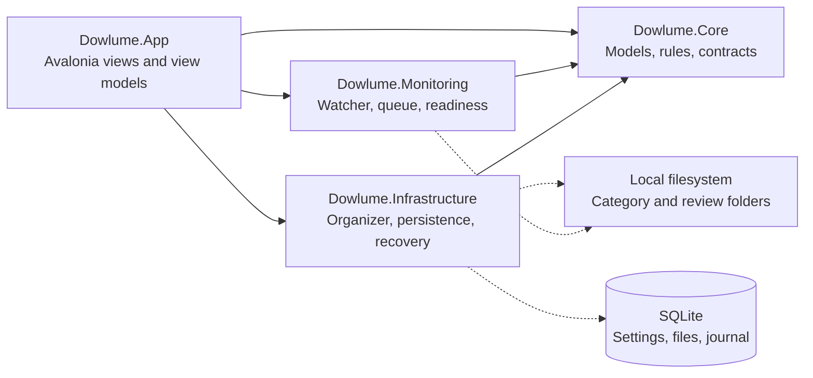

# Architecture and safety boundaries

[English](#) · [Español](../es/architecture/overview.md)

The [domain model](../requirements/domain-model.md) explains the conceptual vocabulary, business rules, and UML behavior of the MVP. This reference describes the components and mechanisms that implement that behavior.

## Project responsibilities

| Project | Responsibility |
| --- | --- |
| Dowlume.Core | Immutable records, category validation, classification, lifecycle rules, service contracts. No UI or SQLite dependency. |
| Dowlume.Monitoring | FileSystemWatcher, bounded channel, deduplication, readiness observations, periodic discovery. Depends only on Core. |
| Dowlume.Infrastructure | SQLite persistence, path checks, verified moves, operation orchestration, Windows/macOS integration, diagnostics. Native recycling is disabled. |
| Dowlume.App | Avalonia views, view models, dialogs, tray behavior, constructor-based composition and shutdown. |
| Dowlume.Tests | Unit, disposable-filesystem integration, disabled-recycle safety, and headless desktop workflow tests. |

## Component diagram

Solid arrows show project references; dotted arrows show runtime access.



`Dowlume.Tests` references all four projects for domain, integration, monitoring, and headless desktop checks. The application composition root supplies a `DownloadOrganizer` callback to the monitor; Monitoring does not reference Infrastructure.

## Engineering challenges

### Detecting completed downloads

A Created or Changed event can arrive while the browser still writes a file, and watcher events can be missed. `DownloadMonitor` treats events as hints, deduplicates work in a bounded channel, and uses startup and periodic scans to rediscover candidates. `FileReadiness` checks a three-second write-age margin, stable size and last-write time across two observations 300 ms apart, and an exclusive-open probe. Browser partial-download extensions are excluded.

This trades a small delay for conservative detection; it cannot prove that another application will never reopen the file. [Monitoring tests](../../tests/Dowlume.Tests/MonitoringTests.cs) exercise incomplete downloads, rename, locked files, burst handling, and restart discovery.

### Protecting files when operations fail

Another file may already occupy a destination, or a source may change after preview. On Windows, `SafeFileMover` verifies the expected SHA-256 under a read handle that denies new writers, uses no-overwrite moves, and verifies the result. The organizer selects numeric suffixes for name collisions and journals before acting. Cancellation is honored before journal creation; once journaled, the operation finishes or records its failure before shutdown completes.

Windows cross-volume moves remain non-atomic; macOS refuses them. If an interruption leaves conflicting copies, recovery preserves them for inspection instead of choosing one to delete. [Safety tests](../../tests/Dowlume.Tests/SafetyTests.cs) and [organizer tests](../../tests/Dowlume.Tests/OrganizerTests.cs) cover collisions, changed content, cancellation, and interrupted operations; physical cross-volume acceptance remains a [release gate](../development/releasing.md).

### Reconciling SQLite with the filesystem

A filesystem move and a SQLite commit cannot form one shared transaction. The organizer first persists a Pending operation with before/after snapshots and paths. After a verified move, `SqliteStateStore.CompleteOperation` commits the tracked record and Completed journal status together. Recovery compares recorded paths and content hashes with disk, also requiring native identity on macOS, before completing or failing an interrupted operation.

For example, a crash after moving `report.pdf` but before the database commit leaves a Pending entry. If only the matching destination exists, recovery completes the database state; if both copies exist, it records NeedsAttention and blocks automatic actions on that file. [Recovery coverage](../../tests/Dowlume.Tests/OrganizerTests.cs) includes failures before and after the move and ambiguous copies. See [Operation journal and recovery](#operation-journal-and-recovery) for undo and recycle limits.

## Processing

```text
Watcher hints + startup/15-second scan
    -> deduplicated bounded channel (256 paths)
    -> one consumer
    -> readiness and path checks
    -> category rule
    -> persist Pending journal entry
    -> verified no-overwrite move
    -> transaction: tracked state + Completed journal entry
```

Watcher events are hints. Queue overflow is recovered by later scans. Managed destinations are not watched recursively. Windows readiness uses a three-second write-age margin, two stable observations and an exclusive-open probe. macOS uses a native nonblocking regular-file descriptor, a three-second write-age margin and metadata verification; the mover separately verifies identity and content. Cancellation is checked before journal creation. Once journaled, an operation finishes or records its failure before shutdown completes.

`DownloadOrganizer` serializes file mutations through one semaphore. This covers monitoring, lifecycle checks, user actions, recovery, and undo. SQLite connections are short-lived and use parameterized statements, WAL, full synchronization, and a busy timeout. Schema version 1 stores versioned settings, tracked records, and operations as JSON payloads in separate tables. A database created by a newer schema is refused.

The application takes an exclusive profile lock before opening its database. It does not auto-start monitoring after a restart. All dependencies are supplied through constructors in the application composition root; a service locator or DI container is unnecessary for this scope.

## Lifecycle

```text
Untracked -> Organized -> InReview
                             |-> Kept (no further aging)
                             |-> Snoozed -> InReview after 7 days
                             |-> Moved (outside application management)
Managed file disappears -> Missing
```

First-seen time is preserved throughout decisions and undo. Keep and Snooze are persisted, not inferred from filesystem timestamps. Existing untracked category contents are left alone.

`Recycled` and `OperationKind.Recycle` remain readable for historical journals, but current versions cannot create that transition. No database migration or enum renumbering is needed. Recoverable quarantine is [future design work](../archive/recycle-capacity-investigation.md#proposed-recoverable-quarantine).

## Operation journal and recovery

Each entry contains an ID, kind, status, UTC timestamp, source/destination, before/after file snapshots, optional undo link, and a user-safe error. State and completion are committed in one SQLite transaction after the filesystem action. This is not a transaction across SQLite and the filesystem: Pending entries bridge that gap.

Recovery verifies SHA-256 before completing a move that reached its destination. Conflicting or missing copies remain NeedsAttention and block further automatic operations for that file/path. Historical Recycle is inspected before move recovery: a matching source marks the attempt Failed, while absent or changed content stays NeedsAttention, even if a destination is recorded. It is never replayed, inferred complete, or promised recoverable. Completed historical records remain unchanged. Failure handling continues reconciliation for unrelated files.

Undo verifies that the selected operation is the latest completed action on the file, that no completed undo references it, and that the current tracked record still matches. Restoring to an occupied path fails instead of overwriting. Undoing an initial organization creates a Kept record at the original path to prevent a watcher loop. Undoing a review move snoozes the restored file for seven days to prevent an immediate lifecycle loop.

## Filesystem safety

- Compare normalized paths with a directory separator boundary; prefix matching alone is insufficient.
- Reject reparse points in every existing ancestor, including destination paths.
- Validate category names, reserved Windows names, extension uniqueness, and bounded review periods.
- Recheck paths before moving; never pass `overwrite: true` for user-file moves.
- On Windows, hold a source handle with read/delete access that denies other writers and deleters. Rename that handle without replacement; for another volume, copy through Windows, verify the destination's main-stream hash under a read lock, then mark only the verified source handle for deletion. Windows copying preserves alternate streams.
- Hold ancestor directory handles without delete sharing while mutating paths to prevent concurrent folder renames. Recheck reparse points after acquiring each handle.
- Disable recycling at the UI command, public organizer method, internal executor, and compatibility adapter before filesystem access or journal creation. The organizer has no recycle-adapter dependency. The original COM adapter and progress sink are [archived as text](../archive/native-recycle/README.md), excluded from compilation and packaging.
- Never empty or add items to the user's Recycle Bin. Source removal is limited to verified cross-volume moves; there is no standalone delete operation.

Path checks reduce ordinary link and rename hazards but are not a security boundary against a hostile same-user process. Cross-volume moves are non-atomic and may require manual reconciliation. Hashing is streamed, so memory use does not grow with file size; processing time does grow with it. Organizer and recovery queries still read record collections into memory and are intended for personal download folders, not millions of files.

## Activity history queries

Activity reads pages of 50 operations from the existing schema, with parameterized action, status, and source/destination search filters. Only the selected page is deserialized. Counts and page contents share a SQLite read transaction. Literal text matching uses an ordinal, case-insensitive .NET function, including Unicode case comparison, rather than SQL wildcard patterns. See the [Microsoft.Data.Sqlite function API](https://learn.microsoft.com/en-us/dotnet/standard/data/sqlite/user-defined-functions) and [SQLite JSON extraction](https://www.sqlite.org/json1.html).

Rows follow reverse insertion order, consistent with the journal's existing ordering. Navigation captures the highest row sequence when leaving the live first page, keeping newly inserted operations from shifting older pages. Existing statuses remain current; the page is clamped if filtering leaves fewer results. Searching again, clearing filters, or returning to page one includes new arrivals. Refreshes are serialized, stale filter results are discarded, and shutdown waits for an active read.

The attention count queries all Pending and NeedsAttention entries independently of paging and filters. Undo still consults the complete journal and applies the original safety checks. No database migration or journal pruning is needed. Search and counts still scan JSON records; pagination bounds materialized history, not query time for arbitrarily large profiles. [History tests](../../tests/Dowlume.Tests/OperationHistoryTests.cs) cover pagination, concurrent arrivals between reads, updates, literal searches, and filter validation.

## Interface languages

Localization belongs to `Dowlume.App`, using matching .NET resource files and a window-scoped `Localizer`. Bindings observe language changes, including values inside existing file/history rows. The application persists the `en`/`es` preference in the versioned settings JSON, defaulting to English when absent or unsupported; no schema migration is needed. Changing language saves only that preference against the saved settings, retaining unsaved form edits and the current preview. It does not rename folders, move files, or rewrite journal entries.

Recognized historical messages are translated at presentation time; unknown messages are retained verbatim. Dates are displayed in local time with the selected culture. Enum values, paths, and diagnostic codes are language-independent. Native folder-picker controls follow the operating system language. A startup failure before settings can be read uses the English fallback.

## Diagnostics and references

The bounded diagnostic log rotates at approximately 1 MB and excludes exception messages and stack traces because they can reveal paths. The private journal intentionally retains paths for recovery.

Primary API references used by the implementation:

- [FileSystemWatcher and buffer overflow behavior](https://learn.microsoft.com/en-us/dotnet/api/system.io.filesystemwatcher?view=net-10.0).
- [Handle-based rename and disposition](https://learn.microsoft.com/en-us/windows/win32/api/fileapi/nf-fileapi-setfileinformationbyhandle) and [Windows file copying](https://learn.microsoft.com/en-us/windows/win32/api/winbase/nf-winbase-copyfilew).
- Historical native investigation: [Windows file-operation flags](https://learn.microsoft.com/en-us/windows/win32/api/shobjidl_core/nf-shobjidl_core-ifileoperation-setoperationflags), [pre-delete cancellation](https://learn.microsoft.com/en-us/windows/win32/api/shobjidl_core/nf-shobjidl_core-ifileoperationprogresssink-predeleteitem), and [transfer flags](https://learn.microsoft.com/en-us/windows/win32/api/shobjidl_core/ne-shobjidl_core-_transfer_source_flags). These APIs are no longer used for recycling by Dowlume.
- [Avalonia storage dialogs](https://docs.avaloniaui.net/docs/services/storage/storage-provider) and [headless rendering](https://docs.avaloniaui.net/docs/testing/setting-up-the-headless-platform).

## macOS 0.4.0 adapter

The macOS adapter prepares native moves before Pending, retaining the source and parent descriptors. It requires local same-volume APFS, rejects links and known cloud locations, uses exclusive atomic rename, flushes directory changes, and verifies identity and content afterward. Volume UUID, inode and birth timestamp travel in optional schema-1 journal fields. Recovery verifies identity and SHA-256 on the same opened descriptor, then verifies the path still names that object.

macOS uses cooperative locks, which cannot exclude arbitrary POSIX writers. A race can move a replacement before verification detects it; the adapter retains files and reports NeedsAttention with an observed original-object path where available. Ambiguous paths are never deleted or rolled back. See the [native contract](file-operations.md) and [implementation/tests](macos.md).
