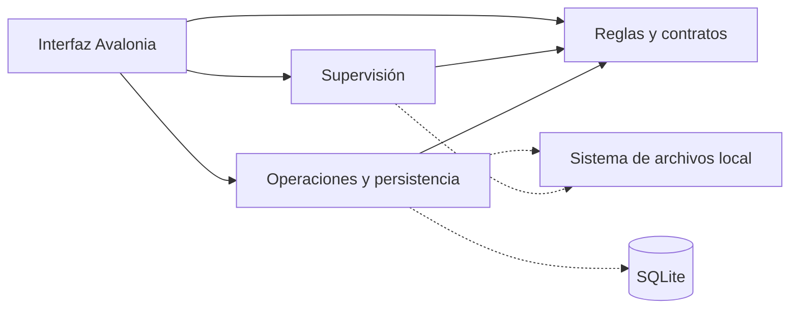

# Arquitectura y límites de seguridad

[English](../ARCHITECTURE.md) · [Índice en español](README.md)

Separo las reglas del dominio, los mecanismos de supervisión, la persistencia y la interfaz. En el [modelo de dominio](requirements/DOMAIN_MODEL.md) explico los conceptos; aquí describo cómo los implemento.

## Responsabilidades

| Proyecto | Responsabilidad |
| --- | --- |
| `Dowlume.Core` | Registros inmutables, categorías, validación, clasificación, ciclo de vida y contratos. Sin interfaz ni SQLite. |
| `Dowlume.Monitoring` | `FileSystemWatcher`, canal limitado, eliminación de eventos duplicados, comprobaciones de disponibilidad y descubrimiento periódico. Solo depende de Core. |
| `Dowlume.Infrastructure` | SQLite, validación de rutas, movimientos verificados, recuperación, integración Windows/macOS y diagnóstico. Papelera nativa desactivada. |
| `Dowlume.App` | Vistas Avalonia, modelos de vista, diálogos, bandeja, composición por constructor y cierre. |
| `Dowlume.Tests` | Pruebas de dominio, sistema de archivos desechable, seguridad y flujos de escritorio sin pantalla. |

La aplicación conecta el organizador con el monitor mediante callbacks. Monitoring no referencia Infrastructure. Uso dependencias por constructor; no necesito un localizador de servicios ni un contenedor de inyección para este alcance.



## Descargas completas

Trato los eventos de creación, cambio y renombrado como indicios. Uso un canal de 256 rutas, elimino duplicados y proceso con un solo consumidor. Los recorridos iniciales y periódicos cada 15 segundos recuperan eventos perdidos o desbordamientos. No recorro las categorías de forma recursiva.

Antes de mover compruebo un margen de tres segundos desde la última escritura, tamaño y fecha estables en dos observaciones separadas por 300 ms, y apertura exclusiva. Excluyo las extensiones parciales de los navegadores. Esto introduce una pequeña espera y reduce movimientos prematuros, pero no garantiza que otra aplicación no reabra el archivo.

## Movimientos e interrupciones

`SafeFileMover` verifica SHA-256 bajo un identificador que impide nuevos escritores, evita sobrescribir y comprueba el resultado. Para colisiones elijo sufijos numéricos. Registro una operación Pendiente antes del movimiento y confirmo el estado del archivo y la operación en una misma transacción SQLite después.

No puedo crear una transacción común entre NTFS y SQLite. Si el proceso se interrumpe, comparo las rutas y huellas registradas con el disco. Si solo existe un destino coincidente, completo el registro. Si solo existe el origen coincidente, marco la operación como fallida. Con ambas copias, ninguna o contenido diferente, conservo todo y marco Requiere atención.

Entre volúmenes no hay atomicidad. Copio mediante Windows, verifico el flujo principal del destino y elimino únicamente el origen a través del identificador verificado. La copia de Windows conserva flujos alternativos. Las pruebas simuladas complementan la aceptación sobre volúmenes físicos; no la sustituyen.

Compruebo la cancelación antes de crear el registro. Una vez registrado, dejo que el intento termine o guarde su fallo antes de cerrar. Un semáforo del organizador serializa supervisión, revisión, recuperación y deshacer.

## Persistencia y ciclo de vida

Abro conexiones SQLite breves con consultas parametrizadas, WAL, sincronización completa y tiempo de espera. El esquema 1 almacena ajustes versionados, archivos y operaciones como JSON en tablas separadas. Rechazo bases creadas por un esquema posterior. Un bloqueo exclusivo del perfil evita abrirlo dos veces.

```text
Sin registrar → Organized → InReview
                              → Kept
                              → Snoozed → InReview tras 7 días
                              → Moved
Archivo gestionado ausente → Missing
```

Conservo la fecha de primera organización al revisar o deshacer. Persisto las decisiones Conservar y Posponer. No importo contenido no registrado de las categorías. Mantengo `Recycled` y `OperationKind.Recycle` para leer historiales antiguos, aunque la versión actual no puede crear esa transición.

## Historial, recuperación y deshacer

Cada operación contiene identificador, tipo, estado, fecha UTC, rutas, instantáneas anterior y prevista, referencia opcional a la acción deshecha y error apto para mostrar. Los registros Pendiente y Requiere atención bloquean nuevas acciones sobre el archivo o sus rutas mientras exista incertidumbre.

Inspecciono los envíos históricos a la papelera sin repetirlos. Un origen intacto permite marcarlos como fallidos; el contenido ausente o distinto sigue requiriendo atención, incluso si se registró un destino. No infiero éxito ni prometo que Windows conserve una copia.

Para deshacer exijo la última acción completada compatible, un estado registrado coincidente, contenido intacto, destino libre y ausencia de otro deshacer completado. Deshacer Organizar devuelve el archivo como Conservado; deshacer Revisión lo pospone siete días. El historial original permanece.

## Seguridad del sistema de archivos

- Comparo rutas normalizadas respetando límites de directorio.
- Rechazo enlaces y reparse points en todos los antecesores existentes, también en destinos.
- Valido nombres reservados de Windows, carpetas únicas, extensiones y plazos de 1 a 3650 días.
- Mantengo identificadores de directorios sin compartir eliminación mientras cambio rutas y vuelvo a comprobar sus propiedades.
- En Windows mantengo el origen verificado abierto con acceso de lectura/eliminación, rechazando escritores y sustituciones concurrentes.
- Desactivo la papelera antes de acceder al sistema de archivos o crear registros, en interfaz, API, ejecutor y adaptador.
- Conservo el antiguo código COM como [texto archivado](archive/native-recycle/README.md), fuera de compilación y empaquetado.

No vacío ni añado archivos a la Papelera del usuario. La única eliminación de origen forma parte de un movimiento entre volúmenes ya verificado. Estas protecciones no son una frontera de seguridad frente a un proceso hostil con los mismos privilegios.

## Consultas de Actividad

Cargo páginas de 50 operaciones; solo deserializo la página elegida. Calculo recuento y contenido bajo una transacción de lectura. Las búsquedas literales ignoran mayúsculas mediante comparación ordinal de .NET, sin interpretar comodines SQL.

Al abandonar la primera página fijo la secuencia máxima para evitar desplazamientos por nuevas operaciones. Los estados sí se actualizan y ajusto la página si el filtro reduce resultados. Volver al inicio, limpiar o buscar incorpora nuevas llegadas. Serializo refrescos, descarto resultados de filtros obsoletos y espero a lecturas activas al cerrar.

El contador global de atención consulta todas las operaciones afectadas. La paginación limita la memoria del historial, no el tiempo de búsqueda en perfiles enormes. Las consultas del organizador y recuperación siguen leyendo colecciones completas; el objetivo son carpetas personales.

## Idiomas

Uso recursos .NET y un `Localizer` por ventana en `Dowlume.App`. Los enlaces observan los cambios, incluidas las filas ya visibles. Persisto `en` o `es` en los ajustes JSON; los perfiles antiguos y códigos desconocidos usan inglés. No necesito migración del esquema.

Al cambiar de idioma guardo solo esa preferencia sobre los ajustes persistidos y conservo la edición pendiente del formulario y la vista previa. No renombro carpetas, muevo archivos ni reescribo el historial. Traduzco mensajes históricos reconocidos al mostrarlos; los desconocidos conservan su texto. Las fechas se presentan en hora local con la cultura elegida. El selector nativo sigue Windows y un fallo anterior a leer los ajustes utiliza inglés.

## Diagnóstico y referencias

Roto el registro de diagnóstico al alcanzar aproximadamente 1 MB. Excluyo mensajes de excepción y trazas porque podrían revelar rutas. El historial privado sí conserva rutas para recuperar operaciones.

Mantengo las referencias primarias de Windows, SQLite y Avalonia y los enlaces a pruebas en la [versión inglesa](../ARCHITECTURE.md#diagnostics-and-references), junto al detalle de los límites de cada componente.

## Adaptador macOS 0.4.0

Preparo movimientos antes de Pending, reteniendo descriptores de origen y padres. Exijo APFS local del mismo volumen, rechazo enlaces/ubicaciones de nube, uso renombrado atómico exclusivo, sincronizo carpetas y verifico identidad/contenido después. Guardo UUID de volumen, inodo y nacimiento en campos opcionales del diario de esquema 1. La recuperación verifica identidad y SHA-256 en el mismo descriptor y comprueba que la ruta sigue nombrando ese objeto.

Las garantías de exclusión y copia entre volúmenes descritas para Windows no se trasladan a macOS: rechazo transferencias entre volúmenes y uso bloqueos cooperativos, sin excluir cualquier escritor POSIX. Una carrera puede mover un sustituto antes de detectarla; conservo archivos y registro NeedsAttention con la ruta observada del objeto original cuando está disponible. Nunca borro ni revierto rutas ambiguas. Uso disponibilidad nativa no bloqueante y antigüedad de escritura, con verificación separada del adaptador. Consulta [contrato](FILE_OPERATION_CONTRACT.md) e [implementación/pruebas](MACOS_IMPLEMENTATION.md).
