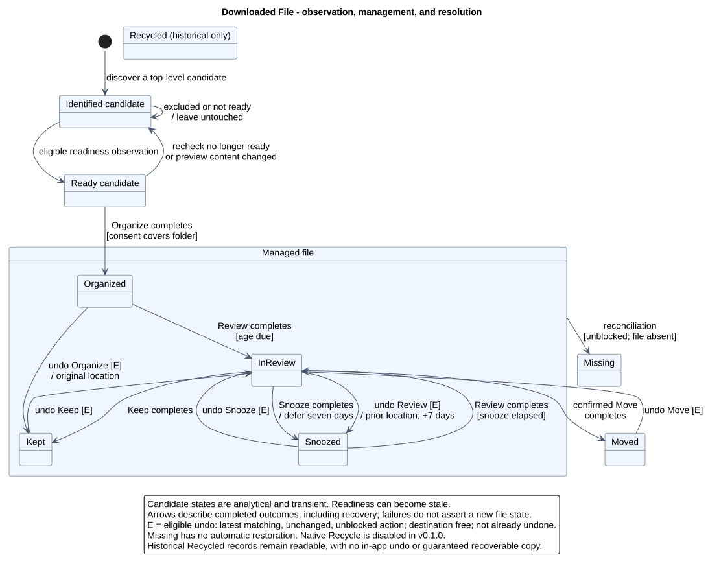
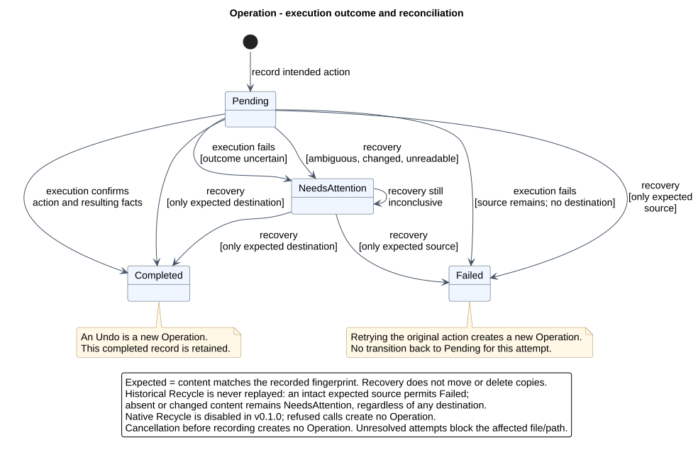
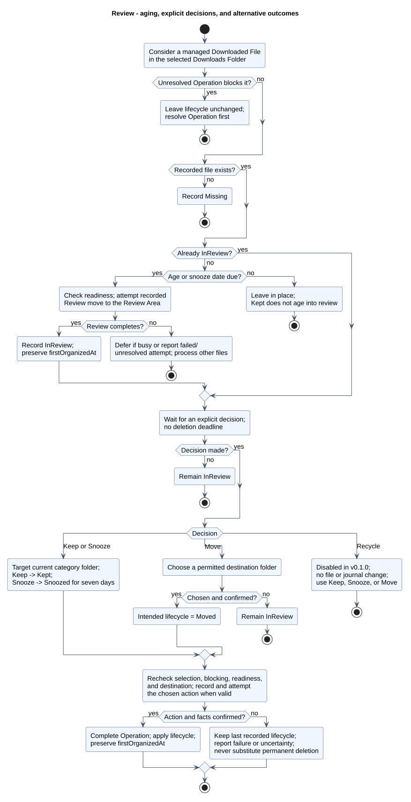

# Domain model

## 1. Introduction and scope

Dowlume helps a person organize completed downloads and decide what to do with aging files. Its domain is **local download organization, review, and accountable file actions**. The central questions are which files may be organized, where they belong, when they should be reviewed, and what can safely be concluded after an action or interruption.

This model describes the **implemented Windows MVP**, examined at application revision `a4b1c9a` on 2026-10-15. It is an analysis model reconstructed from the application's observable behavior, documentation, domain rules, and tests. It is not a proposed redesign, a database schema, or a diagram of C# classes. No domain-expert interviews or independent acceptance validation are claimed.

The 2026-10-17/18 containment update disables native recycling for v0.1.0. The three affected activity/state diagrams and rules below reflect that restriction; historical Recycle/Recycled values remain readable. The other conceptual views are preserved. [Recoverable quarantine](../RECYCLE_CAPACITY_INVESTIGATION.md#proposed-recoverable-quarantine) remains future work.

The method follows the progression from candidate concepts to associations and information-bearing attributes described in [mmasias/idsw1: Domain Model](https://github.com/mmasias/idsw1/blob/main/temario/contenidos/00004-MdD.md). The presentation follows the complementary class, object, and state views in [mmasias/hdC: Domain Model](https://github.com/mmasias/hdC/blob/main/docs/UMLdocs/mdd.md), adding activities and sequences where they clarify Dowlume's behavior. The concepts and scenarios below were analyzed specifically for Dowlume.

The boundary includes one configured local Downloads Folder at a time, extension-based classification, preview and consent, aging into a Review Area, explicit decisions, operation history, undo, and reconciliation. Historical files and operations can survive a change of selected folder. Network/cloud storage, automatic permanent deletion, content-based classification, duplicate-content detection, and simultaneous monitoring of multiple folders are outside the current MVP.

This phase documents only the domain model. Actor catalogs, requirements specifications, and use-case specifications are intentionally deferred. The `docs/requirements/` location does not imply that those other artifacts have been created. Implementation mechanisms belong in [Architecture](../ARCHITECTURE.md); practical instructions belong in the [User guide](../USER_GUIDE.md).

### Reading the representations

| Perspective | Diagrams | Question answered |
| --- | --- | --- |
| Static structure | Three class models and one object snapshot | What concepts exist, what facts matter, and how are they related? |
| Entity evolution | Downloaded File and Operation states | What changes over the lifetime of each entity? |
| Processes | Organization and review activities | Which decisions and alternative paths determine an outcome? |
| Temporal interaction | Organization and recovery sequences | In what order are observations, consent, actions, and confirmations made? |

Each image is a committed SVG. Its adjacent links open the full vector image and editable PlantUML source. [Rendering instructions](diagrams/domain-model/README.md) explain reproduction and validation.

## 2. Candidate conceptual classes

Candidate nouns were extracted from the current workflow and checked against actual information and behavior. A noun is not automatically a class: it may be a value, a state, an action, an external context, or an implementation mechanism.

| Candidate | Assessment | Decision |
| --- | --- | --- |
| Download, file, tracked file | The item being organized and reviewed; it has a continuing history during management. | Select **Downloaded File**, including a transient candidate before tracking. |
| Downloads folder | Defines the discovery boundary and provides context for organization. | Select **Downloads Folder**. |
| Category, document, image, video, archive, installer, other | Classification vocabulary; the six labels do not have different identities or behavior as file subclasses. | Select **Category** with six fixed names; reject six subclasses. |
| Settings, classification rule, retention period, excluded extension | Settings contain both policy and technical/UI concerns. Classification and review timing are meaningful domain rules. | Select **Organization Policy** and **Category Rule**; retain extensions and periods as values. |
| Expiring Files, review queue, review folder | A place to hold files awaiting a decision; the queue is a presentation of those files. | Select **Review Area**; no separate queue entity. |
| Preview, proposed destination | A transient statement of what organization would do, tied to observed content and policy. | Select **Preview** and **Organization Proposal**. |
| Action, operation, activity history, interrupted action | A recorded attempt can succeed, fail, or remain uncertain, independently of the file's lifecycle. | Select **Operation**; history is its ordered collection. |
| Previous state, intended state | Historical facts needed to interpret an attempt and an eligible undo. | Select **File Condition**, an immutable value within an Operation. |
| Keep, Snooze, Move, Recycle, Undo | Actions with consequences, not independent durable objects with separate identities. | Model as Operation kinds and state transitions. |
| Age, filename, path, extension, content hash | Descriptive or comparison values. A fingerprint checks content, not global file identity. | Model as attributes or derived values. |
| User, browser, operating system, Recycle Bin | External context for instructions, file production, and recycling. | Mention where behavior requires it; no actor model in this phase. |
| Watcher, bounded channel, semaphore, SQLite, repository, view model, window, tray | Mechanisms for realizing the behavior, not concepts of download organization. | Exclude; see Architecture. |
| AI classifier, cloud account, duplicate group | No corresponding MVP capability. | Exclude. |

## 3. Selected concepts and modeling decisions

| Concept | Meaning and justification |
| --- | --- |
| **Downloads Folder** | A local folder considered as a discovery context. Only its direct files are discovered. Its role persists conceptually in historical file origins even after another folder is selected. |
| **Organization Policy** | The current choice of Downloads Folder, exclusions, and six Category Rules. It is domain policy, not a representation of all application settings. |
| **Category** | One of Documents, Images, Videos, Archives, Installers, or Other. A category is a classification, not a physical directory. |
| **Category Rule** | The current treatment of a Category: matching extensions, category folder name, and days until review. Keeping the rule separate allows a category to remain the same while its folder name or review period changes. |
| **Downloaded File** | A file considered for organization, and its known facts during a tracking episode. Organization, review, and decisions retain that episode's identity. Untracked candidates need not have stored records. |
| **Review Area** | The designated `Expiring Files` location beneath a Downloads Folder. It holds files pending a decision; it is neither a deletion schedule nor a category. |
| **Preview** | The current transient set of proposed organizations, with the policy values used to produce it. It can be empty and is not retained as historical consent evidence. |
| **Organization Proposal** | One candidate's observed source, proposed category/destination, and observed content. A proposal does not reserve a destination or authorize a move by itself. |
| **Operation** | An accountable attempt to change a file's location or lifecycle, with recorded intent, outcome, and optional reference to an action being undone. It remains meaningful even when the first organization has not produced a tracked file record. |
| **File Condition** | A value describing the file facts before an Operation or intended after it. It is not another Downloaded File, a physical copy, or an independently managed entity. |

### Identity, values, and boundaries

- **Identity is local to a tracking episode.** A filename or fingerprint is not an identity. Two files may have the same name or content. Re-importing a file after it leaves management can create a new tracking record; the MVP does not establish global identity across copies or external renames.
- **Recorded location is knowledge, not guaranteed presence.** A Missing file has a last recorded location. A Recycled file retains its prior location in history, not a browsable Recycle Bin address. An interrupted operation may already have moved the physical file while its recorded lifecycle still reflects the prior state.
- **First organization is the aging origin.** `firstOrganizedAt` names the domain meaning of the implementation's first-seen time. It is assigned when the initial organization is attempted, retained when that attempt completes or is recovered, and preserved through subsequent decisions and undo. It is not a browser download timestamp or the first watcher notification. A fresh retry of a failed initial attempt can start a new tracking episode.
- **Consent is an event with scope.** Confirmation authorizes organization of the selected folder's previewed files and future/unfinished arrivals during monitoring. It is not a durable Consent class: monitoring starts paused after a restart and must be explicitly resumed through preview and confirmation.
- **Places are not storage ownership.** The Downloads Folder association records discovery context, not current containment. A file may later be in a category folder, the Review Area, or a chosen destination. Current and historical locations are values. Category folders are derived from the selected root and rule; they do not need another conceptual class.
- **History is independent of outcome.** Operation is selected because the person can inspect attempts and resolve uncertainty. SQLite tables and transactions are deliberately absent. File Conditions express recorded facts without copying a database schema.

## 4. Class diagrams and evolution

The three models are successive refinements of the same MVP, not historical application versions or planned functionality. Earlier views omit detail; the detailed view supplies the complete selected vocabulary.

### 4.1 Initial model: fundamental concepts

[Full SVG](diagrams/domain-model/svg/classes-initial.svg) · [PlantUML source](diagrams/domain-model/src/classes-initial.puml)

This view identifies the item being managed, its discovery context, its classification, and the holding area. Associations express initial meanings without claiming multiplicities yet. It establishes that classification and review location are different ideas.

### 4.2 Intermediate model: associations and multiplicities

[Full SVG](diagrams/domain-model/svg/classes-intermediate.svg) · [PlantUML source](diagrams/domain-model/src/classes-intermediate.puml)

The policy explains how classification and age thresholds are configured. Operations add a history of attempts without making file lifecycle and execution outcome the same thing. Multiplicities are read within one configured application profile and its retained history: one policy selects one folder; older folders may have no current selecting policy.

### 4.3 Detailed model: facts, proposals, and historical conditions

[Full SVG](diagrams/domain-model/svg/classes-detailed.svg) · [PlantUML source](diagrams/domain-model/src/classes-detailed.puml)

This view adds the transient information that supports informed consent and the historical values needed for recovery and undo. There are no methods, controllers, foreign keys, database tables, or implementation interfaces. Compositions express policy rules, preview items, and historical values belonging to their containing concepts, not deletion of user files.

### Association constraints

| Association | Interpretation and constraint |
| --- | --- |
| Organization Policy — Downloads Folder | Each configured policy selects exactly one folder. A folder has zero or one currently selecting policy in this scope. Unconfigured first launch is outside this configured snapshot. |
| Organization Policy — Category Rule — Category | A policy contains exactly six rules, one for each of the six Categories. Each current rule treats exactly one Category. Historical policy versions are not independently modeled or retained. |
| Downloads Folder — Downloaded File | A file has one original discovery context for the modeled episode; a folder can provide context for any number of files. This does not assert that all of them are still physically inside that folder. |
| Downloads Folder — Review Area | Each folder designates one Review Area. This is a logical place even before its physical directory is created. |
| Category — Downloaded File | A candidate may have no recorded Category; a tracked file has exactly one. Any number of files can share it. Changing classification rules does not reclassify existing tracked files. |
| Organization Policy — Preview | At most one current matching Preview is considered. `policyAtPreview` includes the folder, exclusions, and rule values; changed values require a fresh preview before starting. Old previews are not historical entities. |
| Preview — Organization Proposal | A Preview contains zero or more proposals. Each proposal belongs to that preview, concerns one file, and proposes one Category. A file appears at most once in the current preview. |
| Downloaded File — Operation | A file can be the subject of many attempts; each Operation concerns one file. The conceptual subject can exist before a separate tracked record is committed. |
| Operation — File Condition | Each Operation owns one IntendedAfter condition and zero or one Before condition. Before is absent for initial organization and present for subsequent actions. These are value occurrences, not shared mutable entities. |
| Operation — Operation | Only an Undo refers to an earlier target Operation. A target may have multiple failed/uncertain undo attempts, but at most one completed Undo. This association does not erase or change the target's Completed status. |

### Attribute and value conventions

`[0..1]` means optional; `/` marks a derived value. Attribute names describe domain facts rather than C# member names. The model uses these value domains:

| Value | Meaning |
| --- | --- |
| `CategoryName` | Documents, Images, Videos, Archives, Installers, Other. |
| `FileLifecycle` | Organized, InReview, Kept, Snoozed, Moved, Recycled, Missing. Candidate observations are not additional stored lifecycle values. |
| `OperationKind` | Organize, Review, Keep, Snooze, Move, Recycle, Undo. |
| `OperationStatus` | Pending, Completed, Failed, NeedsAttention. |
| `ConditionPhase` | Before or IntendedAfter; a role within one Operation's historical facts. |
| `FileLocation`, `FolderLocation` | An absolute local location; a recorded value does not prove current existence. A file's derived name comes from its recorded location. |
| `Extension` | A dot-prefixed extension compared without case; used in matching and exclusions. |
| `Instant` | A recorded time compared consistently in UTC. `snoozedUntil` affects aging only while lifecycle is Snoozed; older values can remain in other states without controlling them. |
| `Fingerprint` | An equality check for expected versus observed content. It is not a duplicate-detection rule, identity, or guarantee against every concurrent filesystem change. |
| `PolicyValues` | The selected folder, excluded extensions, and six rule values captured for comparison with the current configuration. |

`firstOrganizedAt`, recorded lifecycle, and expected content are absent for an untracked candidate. An Operation's IntendedAfter condition can already contain those intended facts while its outcome remains Pending. There is no requirement that a pending intended state equal the last confirmed file state.

## 5. Object diagram: an aging report

[Full SVG](diagrams/domain-model/svg/objects-review.svg) · [PlantUML source](diagrams/domain-model/src/objects-review.puml)

This partial snapshot instantiates the selected concepts. All paths, filenames, and content symbols are fictional. `D` abbreviates `C:/Dowlume-Demo/Downloads`, and `H-report` denotes one unchanged content fingerprint.

| Time | Domain fact |
| --- | --- |
| 2026-09-01 09:00 UTC | Organize completes for `D/report.pdf`, classifying it as Documents and moving it to `D/Documents/report.pdf`. |
| 2026-10-01 09:00 UTC | The file becomes due under the Documents rule's 30-day threshold. Becoming due does not itself move a file. |
| 2026-10-15 09:00 UTC | A reconciliation completes Review and moves the unchanged file to `D/Expiring Files/report.pdf`. |
| Snapshot immediately afterward | The file is InReview. Its first organization time and Category are unchanged. Two completed Operations explain its history; no review decision has yet occurred. |

Five other Category/Category Rule pairs and the Organize Operation's IntendedAfter condition are omitted to keep the snapshot legible; they still exist in the modeled configuration. Both conditions of the Review Operation are shown to demonstrate how intended facts become confirmed facts. This is a distinct scenario from the collision example in section 8.1.

## 6. State diagrams

### 6.1 Downloaded File lifecycle

[Full SVG](diagrams/domain-model/svg/states-file.svg) · [PlantUML source](diagrams/domain-model/src/states-file.puml)

The two candidate states describe observations made before tracking. Readiness is temporary and can become stale between preview and action. The remaining named states match the implemented lifecycle vocabulary. The Managed file composite groups Organized, InReview, Kept, and Snoozed because they remain subject to management and missing-file checks.

Arrows represent **confirmed outcomes**, including outcomes confirmed during recovery. An attempted move does not immediately establish its intended lifecycle. Failed and uncertain operations leave the last recorded lifecycle in place even if the physical situation needs inspection. The physical/recorded mismatch belongs to the Operation lifecycle below.

| Event | Result and important condition |
| --- | --- |
| Organize completes | Candidate becomes Organized under valid consent; its initial age origin is retained in history. |
| Review completes | Due Organized or Snoozed file becomes InReview in the Review Area. Kept is not due. |
| Keep completes | InReview becomes Kept in the folder currently configured for its Category; ordinary age checks no longer expire it. |
| Snooze completes | InReview becomes Snoozed in its current category folder, with a deadline seven days after the decision. |
| Move completes | InReview becomes Moved and leaves application management. The chosen destination need not be outside the Downloads Folder. |
| Historical Recycle | Recycled remains readable, but v0.1.0 cannot create this transition. No in-app Undo or guaranteed Windows restoration exists. |
| Reconciliation finds a managed file absent | Record Missing, unless an unresolved Operation blocks the file/path. Merely restoring a Missing file does not automatically restore its prior lifecycle. |
| Eligible Undo of Organize | Return to the original location as Kept, preventing immediate organization again. |
| Eligible Undo of Review | Restore the preceding location as Snoozed for seven days, preventing an immediate review loop. |
| Eligible Undo of Keep, Snooze, or Move | Restore the preceding InReview facts and review location. |

`E` in the diagram abbreviates the eligibility conditions in rule DM-14 below. No final-state marker claims that Kept, Moved, or Recycled means physical destruction. Moved still supports an eligible Undo; restored or re-imported content may enter another tracking episode. External renames and edits do not introduce invented automatic transitions.

### 6.2 Operation lifecycle

[Full SVG](diagrams/domain-model/svg/states-operation.svg) · [PlantUML source](diagrams/domain-model/src/states-operation.puml)

This second state machine is necessary because an attempt has a lifecycle independent of its subject. A file can still be recorded as Organized while a Review attempt is Pending or NeedsAttention. A first Organize attempt can be uncertain before a tracked file record exists.

During execution, an error with the source still present and no destination is recorded as Failed; other uncertain outcomes require attention. Recovery uses stricter evidence: the remaining copy must also match expected content. A failed attempt is retained. Retrying the original action creates a new Operation rather than resetting the failed attempt to Pending.

| Recovery observation for a move | Outcome of that Operation |
| --- | --- |
| Only source exists and matches expected content | Failed; the original action can be retried. |
| Only destination exists and matches expected content | Completed; confirm IntendedAfter facts without moving again. |
| Both exist, neither exists, content differs, or inspection fails | NeedsAttention; preserve existing copies and block automatic actions for the affected file/path. |
| Historical Recycle: original source still exists and matches | Failed; native recycling stays disabled. Safe review decisions remain available. |
| Historical Recycle: source is missing or changed | NeedsAttention; never replay or infer success from a destination. Preserve any actual copies for manual inspection; recovery does not restore missing content. |

Cancellation before an Operation is recorded creates no Operation. A completed Undo is a new history item; the target remains Completed. No extra state machine is added for policy, categories, or Preview because their changes do not warrant independent lifecycle models in this scope.

## 7. Activity diagrams

### 7.1 Organization of downloads

[Full SVG](diagrams/domain-model/svg/activity-organization.svg) · [PlantUML source](diagrams/domain-model/src/activity-organization.puml)

The process shows the initial batch: preview, explicit consent, per-proposal checks, and the start of monitoring. Preview creates proposals without moving newly discovered files or creating category directories. It may reconcile earlier interrupted Operations first, so it is not a promise of zero changes to recorded history.

An empty preview can still authorize monitoring for future arrivals. A no-longer-ready candidate is skipped; changed preview content is rejected. Destination names are recalculated because preview reserves nothing. A failed initial-batch action stops startup before monitoring begins; earlier completed actions in that batch remain completed. The batch is not all-or-nothing.

Future arrivals use the same eligibility, readiness, classification, and operation rules under the existing consent, without requiring an individual new preview. Background failures are reported and do not prevent unrelated files from being processed. The diagram abstracts event delivery, queueing, and scheduling; those mechanisms are described in Architecture.

### 7.2 Aging and review decisions

[Full SVG](diagrams/domain-model/svg/activity-review.svg) · [PlantUML source](diagrams/domain-model/src/activity-review.puml)

This view joins automatic aging with the later explicit decision. They need not occur in one application session: the wait at InReview can last indefinitely. “Age or snooze date due” means the exact lifecycle-dependent predicates in DM-08. Before reconciliation acts, interrupted Operations are considered; any unresolved block takes precedence over missing-file or age processing.

| Decision | Destination | Confirmed lifecycle | Additional interaction |
| --- | --- | --- | --- |
| Keep | Folder currently configured for the recorded Category | Kept | Selecting Keep executes the decision; no additional confirmation dialog. |
| Snooze | Folder currently configured for the recorded Category | Snoozed, with a seven-day deadline | Selecting Snooze executes the decision; no additional confirmation dialog. |
| Move | A permitted explicitly chosen folder | Moved | Choose a destination and confirm. Canceling either step leaves InReview. |
| Recycle (disabled) | No filesystem or journal change | Unchanged | Refused in the UI and internal execution. Historical Recycled records retain their meaning; quarantine is future work. |
| No decision | Existing review location | InReview | Wait without any automatic deletion deadline. |

Readiness, unchanged content, location validity, and unresolved-operation checks still apply to decisions. A precondition rejection need not create an Operation; a recorded attempt can fail or require attention. A failure concerning one file does not imply that every file's review processing fails.

## 8. Sequence diagrams

These sequences show conceptual observations and commitments, not calls between implementation classes. **Dowlume** is a single domain boundary; incoming and outgoing arrows express external requests and results without introducing an actor catalog. Files, policy, preview, and operations are conceptual participants. Location roles in recovery are values being inspected, not additional services.

### 8.1 Preview, consent, and a collision

[Full SVG](diagrams/domain-model/svg/sequence-organization.svg) · [PlantUML source](diagrams/domain-model/src/sequence-organization.puml)

An existing `Documents/report.pdf` belongs to other content. Preview proposes `Documents/report (1).pdf` for a new `report.pdf`. After consent, the file's observed content and destination availability are checked again. Only then is a Pending Organize recorded and a verified move attempted. The existing file is never overwritten.

The alternate fragment rejects changed content without recording an Organize attempt for that proposal. The successful branch assumes readiness still passes and the move succeeds; the activity and Operation state diagrams cover other failures. If destination occupancy changes, another suffix can be selected. The sequence is an illustrative interaction ordering, not an assertion that proposals are reservations or that all failures are reversible automatically.

### 8.2 Reconciling interrupted organization

[Full SVG](diagrams/domain-model/svg/sequence-recovery.svg) · [PlantUML source](diagrams/domain-model/src/sequence-recovery.puml)

This scenario starts with recorded intent and an interrupted Organize. The outcome depends on the observed locations and content. Matching destination-only evidence confirms completion; matching source-only evidence permits a fresh attempt; ambiguous evidence requires inspection. The diagram's confirmation messages describe one logical update to history and file facts, not two separately committed technical calls. The domain model does not attempt to specify a distributed filesystem/database transaction.

## 9. Business rules and constraints

These identifiers index the rules of this model for cross-reference; they are not a new requirements specification or a claim of formal verification.

| Rule | Domain constraint |
| --- | --- |
| **DM-01 — Scope** | Only one configured local folder is monitored at a time. Discovery is nonrecursive: existing subfolders and untracked category contents are not imported automatically. Previously recorded history is retained when the selected folder changes. |
| **DM-02 — Permitted locations** | The selected folder must exist and be local. Drive roots, network shares, protected system/application-data locations, links, junctions, and cloud reparse/placeholder paths are rejected. The implementation permits disposable temporary test locations. Exact platform path checks are outside this conceptual model. |
| **DM-03 — Exclusion and readiness** | Browser partial extensions, configured excluded extensions, and names beginning with `~` are skipped. Eligibility also excludes managed or blocked paths. A readiness observation must pass before moving; an arrival notification is not completion proof. Readiness is conservative evidence, not a guarantee that another program will never reopen the file. |
| **DM-04 — Classification** | Exactly six Categories exist. Extension matching is case-insensitive; each configured extension belongs to at most one Category Rule. Unmatched extensions go to Other. Rules can be edited, including explicit mappings for Other; categories themselves are fixed. |
| **DM-05 — Policy validity** | Category folder names are safe, unique without case, and distinct from `Expiring Files`; review periods are integers from 1 to 3650 days. Configuration changes affect future classification and current age checks. They neither rename existing folders nor recategorize existing tracked files. |
| **DM-06 — Preview and consent** | Preview precedes starting organization and monitoring. Its policy values must still match at start; each proposed file's content is checked again before organization. Confirmation covers the folder's current, future, and unfinished arrivals. Declining leaves monitoring paused. Restart does not restore consent or automatically resume monitoring. |
| **DM-07 — Preservation** | No action overwrites an existing destination or permanently deletes a managed file. Name collisions use an available numeric suffix; inability to find a permissible destination fails the action. Preview does not reserve names. Edited tracked content is not automatically accepted as the expected version. |
| **DM-08 — Aging** | An Organized file is due when `now >= firstOrganizedAt + current category reviewAfterDays`. A Snoozed file is due when `now >= snoozedUntil`. Other lifecycle values are not age-due. Review occurs on a later eligible reconciliation, not necessarily at the exact deadline. |
| **DM-09 — Review** | Review moves the file to an available name in the Review Area and preserves its Category and age origin. InReview has no automatic deletion deadline. Keep, Snooze, and Move require a currently selected InReview file; they are not actions on arbitrary organized files. Recycle is disabled. |
| **DM-10 — Decisions** | Keep excludes future age reviews; Snooze defers review for seven days. Both return to the category folder specified by the current rule, possibly with a collision suffix. Move stops management even if the chosen destination is another permitted subfolder under Downloads; the Downloads root and the current review directory themselves are not permitted Move destinations. |
| **DM-11 — Recycling** | Native Recycle is disabled in v0.1.0 before filesystem access or journal creation. Historical kinds and states remain readable, but absence is not proof of recovery or successful recycling. No native retry or in-app Undo is allowed. Recoverable quarantine is deferred. |
| **DM-12 — Accountability** | Intent is recorded before an action. File facts and Operation completion are confirmed together after the action. Cancellation before recording produces no attempt; after recording, the attempt must finish or retain an outcome that can be reconciled. Initial batches may partially complete. |
| **DM-13 — Recovery** | Only unambiguous expected-content evidence permits recovery to conclude Completed or Failed. NeedsAttention preserves copies, blocks actions on the tracked subject, and blocks discovery at its recorded source/destination paths; it is an Operation status, not a file lifecycle. These checks are not a general reservation of future destinations. Recovery does not delete one of two copies or invent proof of recycling. |
| **DM-14 — Undo** | Only the latest completed, eligible action on the file can be undone: current recorded facts must still match, content must be unchanged and ready, the return location must be free and inside the currently selected root, and no unresolved action or completed Undo may block it. Recycle and Undo Operations cannot themselves be undone. Undo creates another Operation and preserves history. |
| **DM-15 — Undo consequences** | Undo of Organize restores the original location as Kept. Undo of Review restores its prior location as Snoozed for seven days. Undo of Keep, Snooze, or Move restores the preceding InReview condition. First organization time is preserved. After a completed Undo, another earlier action does not simply become undoable: the latest completed Operation is now an Undo. |
| **DM-16 — External changes** | Missing records and external renames are not automatically repaired by rediscovery. Modified content is rejected by operations expecting its old fingerprint. Following external renames, accepting edited tracked content, and deduplicating by fingerprint are outside the MVP. |

The default review periods are **Documents 30, Images 60, Videos 30, Archives 14, Installers 7, Other 30 days**. These are initial policy values, not immutable category properties. The object scenario uses the default Documents period and a valid shortened extension list.

## 10. Conclusions and modeling decisions

The model separates classification from physical location, candidates from confirmed tracking, file lifecycle from operation outcome, and intentions from completed facts. These distinctions explain normal organization as well as interruptions without turning the model into an implementation diagram.

The complementary views share the same vocabulary. Class multiplicities allow empty previews, unclassified candidates, many historical attempts, and optional prior conditions. The object snapshot instantiates the Review transition without inventing early aging or automatic decisions. Activities include consent, cancellation, stale content, deferred readiness, and failures. Sequences expose the order in which evidence, intent, and outcome become known.

### Deliberate simplifications

- Paths and fingerprints are values. Physical duplicate copies caused by an interruption are represented by observed locations during recovery, not by adding a new duplicate-management feature.
- Six fixed Categories are instances of a concept, not subclasses. A rule includes a period because the MVP configures it alongside classification, without introducing a separate generalized retention-policy framework.
- No durable Preview history, Consent ledger, autonomous decision agent, or separate Folder repository is implied. Domain concepts need not have one corresponding persisted C# object.
- File Conditions use a `phase` value to distinguish Before from IntendedAfter. Each occurrence belongs to one Operation; their ownership says nothing about deleting physical files.
- The File state machine describes one episode. It does not claim automatic identity continuity after external rename, completed recycling/restoration, or re-import. Candidate readiness and filesystem facts can change between observations.
- No finality claim is made for a physical file outside Dowlume. Moved, Recycled, and Missing describe the application's knowledge and management boundary.
- No low-level queue, locking, hashing algorithm, database, or shell call appears as a class or sequence participant. Those choices remain in Architecture, including cross-volume and hostile-process limitations.

### Evidence and consistency review

The following links identify the implementation and tests used to check the analysis. They are evidence for the domain behavior, not a prescription to map each concept to a software class. Test links denote existing coverage, not a new test run or exhaustive proof of every rule.

| Model concern | Evidence examined |
| --- | --- |
| Category vocabulary, defaults, exclusions, validation | [AppSettings](../../Dowlume/Dowlume.Core/AppSettings.cs), [FileClassifier](../../Dowlume/Dowlume.Core/FileClassifier.cs), [CoreTests](../../Dowlume/Dowlume.Tests/CoreTests.cs) |
| Candidate readiness and rediscovery | [FileReadiness](../../Dowlume/Dowlume.Monitoring/FileReadiness.cs), [DownloadMonitor](../../Dowlume/Dowlume.Monitoring/DownloadMonitor.cs), [MonitoringTests](../../Dowlume/Dowlume.Tests/MonitoringTests.cs) |
| Preview matching, consent, empty previews, initial-batch behavior | [MainViewModel](../../Dowlume/Dowlume.App/ViewModels/MainViewModel.cs), [DesktopWorkflowTests](../../Dowlume/Dowlume.Tests/DesktopWorkflowTests.cs) |
| Lifecycle and age predicates | [TrackedFile](../../Dowlume/Dowlume.Core/TrackedFile.cs), [LifecyclePolicy](../../Dowlume/Dowlume.Core/LifecyclePolicy.cs) |
| Decisions, recovery, conditions, undo, missing-file handling | [DownloadOrganizer](../../Dowlume/Dowlume.Infrastructure/DownloadOrganizer.cs), [OperationRecord](../../Dowlume/Dowlume.Core/OperationRecord.cs), [OrganizerTests](../../Dowlume/Dowlume.Tests/OrganizerTests.cs) |
| Permitted paths, collision preservation, recycling limits | [PathSafety](../../Dowlume/Dowlume.Infrastructure/PathSafety.cs), [SafeFileMover](../../Dowlume/Dowlume.Infrastructure/SafeFileMover.cs), [SafetyTests](../../Dowlume/Dowlume.Tests/SafetyTests.cs), [DisabledRecyclingTests](../../Dowlume/Dowlume.Tests/DisabledRecyclingTests.cs) |

Review checkpoints are the consistency of association multiplicities, optional facts before tracking, conditions for every lifecycle transition, recovery outcomes, and the object scenario's dates and links. PlantUML syntax, generated SVGs, visual inspection, and documentation links are recorded separately in [Validation](../VALIDATION.md). Application acceptance gates remain unchanged.
