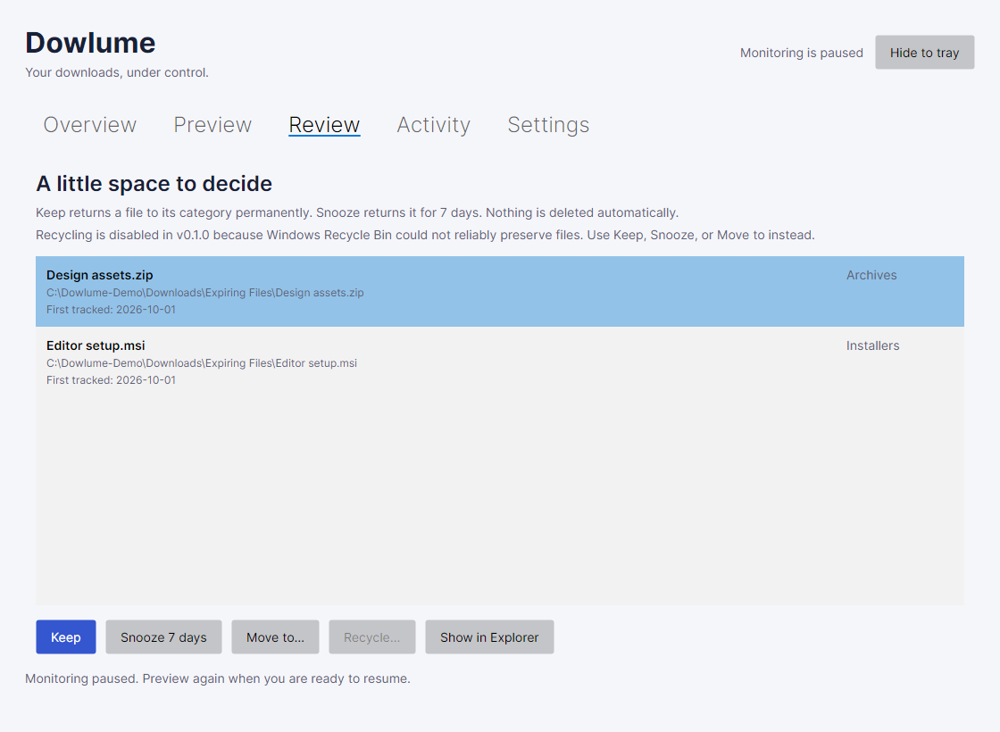

# Using Dowlume

[English](#) · [Español](../es/user/guide.md)

Dowlume organizes completed downloads on Windows x64, macOS Apple Silicon, and Ubuntu 24.04 LTS x64 with GNOME. Version 0.5.0 includes Windows/Ubuntu installers and portable applications with .NET included. Start with copies of sample files in a disposable local folder. See the [platform matrix](platform-support.md) for filesystem and OS requirements.

## Install and start

Choose the Windows installer for a regular installation, or a **Portable** download for the complete application archive. Ubuntu users should follow the [Linux instructions](#linux-050). Download the package for your computer from [GitHub Releases](https://github.com/mglezz/dowlume/releases/tag/v0.5.0). For macOS installation, permissions, and startup, follow the [macOS instructions](#macos-040) below. Developers can also [build and run from source](../development/getting-started.md).

For a downloaded or locally built package, run the setup executable (for example, `Dowlume-0.5.0-win-x64-setup.exe`). Installation is per user and does not require administrator privileges. Alternatively, extract the complete portable ZIP and run `Dowlume.App.exe`; do not move the executable out of its accompanying files. The .NET runtime is included.

The Windows packages are unsigned. The macOS app uses an ad-hoc signature without Developer ID or notarization. Only use a package from a source you trust and compare its SHA-256 checksum with the [download checksums](../releases/0.5.0.md#download-checksums).

The package includes `START-HERE.txt`, which opens offline in a text editor. The installer adds a **Dowlume quick start** Start menu shortcut. Exit Dowlume, including any instance hidden in the tray, before upgrading or uninstalling; Setup refuses while the app is running. Installation and uninstall retain your files and local profile.

## Update without uninstalling (in development for 0.6.0)

Windows installers already support installing a newer version over the existing installation; uninstalling first is unnecessary. Close Dowlume, run the new installer, and retain the existing installation folder. The profile and organized files are retained.

Source builds after 0.5.0 add **Settings → Check for updates**. Pause organization to access Settings. The check contacts the public GitHub release endpoint only when requested, without an account, credentials, file names, or paths; GitHub still receives ordinary connection information such as your IP address. It offers newer stable releases, excluding drafts and prereleases. Network failures leave local organization available.

For a registered Windows installation, **Download and install update…** asks for confirmation, downloads the official installer to a separate temporary folder, verifies its published size and SHA-256, pauses organization, and exits before opening the interactive installer. Complete the installer using the existing folder. No uninstall is needed. The hash verifies consistency with GitHub's release metadata; it is not a publisher signature. Windows packages remain unsigned. A missing checksum or installer offers the official release page instead. If installer launch fails, reopen Dowlume and retry, or use the release page. Downloaded installers remain in the system temporary directory for normal OS cleanup.

Portable Windows copies, macOS, Linux, and custom test profiles use **Open release and instructions**. On Ubuntu, installing the new `.deb` with `sudo apt install ./<new-package>.deb` upgrades the package. For portable copies, close the old application and extract the complete new archive into a separate permanent folder; continue using the existing profile and update any startup/menu registration to the new location. The button does not automatically replace portable applications or run privileged Linux commands.

Version 0.5.0 does not contain this button: reaching the first release that includes it still requires installing that release normally. Native end-to-end acceptance of the new update flow is required before publishing 0.6.0.

## Choose a language

Pause monitoring and open **Settings → Language**. Choose **English** or **Español**. Dowlume applies the choice immediately and saves it automatically for that profile, including when folder settings have unsaved edits. Those edits are not saved by changing language. Restarting retains the language; older profiles default to English.

Tabs, buttons, confirmations, tray items, categories, states, dates, and known error messages follow the selected language. Configured folder names, filenames, paths, and journal data remain unchanged. `Expiring Files` keeps its name in both languages. Unknown historical or operating-system messages retain their original wording. Native folder-picker controls follow the operating system language settings.

The current packages include both interface languages. Older 0.1.0 packages remain English-only.

## First use

1. Open **Settings** and choose an existing local Downloads folder. Dowlume suggests the Windows Downloads known folder or `~/Downloads` on macOS; you can choose a different local folder.
2. Adjust category folder names, extension mappings, excluded extensions, and review periods. Save settings.
3. Open **Preview** and select **Refresh preview**. This step does not move files or create category folders.
4. Review the proposed destinations, then select **Organize and monitor** and confirm. Consent covers previewed files, future arrivals, and unfinished files when they become ready.
5. Check **Overview** and **Activity** to see what happened.

*Preview shows the destination before you consent. All screenshots use the real views with fictional demonstration data; [capture details](../images/README.md).*

*Overview brings together category counts, tracked files, and items that need your attention.*

Only files directly inside the selected folder are discovered. Existing subfolders are not imported or rearranged. Category folders and `Expiring Files` are created when needed. Name collisions receive a numeric suffix; existing files are never overwritten.

Monitoring starts paused on every launch. Preview and confirm again to resume. **Pause** stops the watcher and waits for an active operation. On Windows, **Hide to tray** keeps the application running; use the tray menu to reopen it or exit. Closing the main window stops monitoring.

The Dowlume icon appears in the Windows notification area, sometimes inside the **Show hidden icons** overflow. Click it to restore the window, or right-click for **Open Dowlume** and **Exit**. You can move the icon into the visible notification area using Windows taskbar settings.

On Windows, in **Settings**, enable **Start Dowlume when I sign in** to open this copy of the application at sign-in. The change applies immediately to your account and is off by default. Monitoring still starts paused. Disable the option before relocating a portable copy; enable it again from the new location. Windows Settings can independently disable startup applications. Uninstall removes the startup entry when it belongs to that installation.

## Periodic organization (in development for 0.6.0)

Source builds after 0.5.0 offer **Settings → Organize periodically instead of continuously**. This optional mode is off by default. Choose an interval from 1 to 1440 minutes (10 by default), save, refresh the preview, and select **Organize and monitor** to confirm the schedule.

Nothing is organized immediately in this mode, including previewed files. The first pass waits for the chosen interval. Each pass checks files directly in the selected folder and runs the usual aging/recovery checks. New arrivals are eligible on later passes; partial, busy, recent, excluded, and already tracked files retain the usual protections. Existing subfolders are not imported. Activity and eligible Undo work as before.

There is no filesystem watcher in periodic mode. A full interval follows each completed pass, so slow passes never overlap or accumulate catch-up runs. The application must remain running; this is not an operating-system scheduled task. Sleep can delay checks. **Pause** cancels pending checks and waits for any already journaled operation to finish safely. Changing the interval or mode requires a new preview. Restarting remembers the preference but always leaves organization paused.

## Review files

**Recycling is unavailable:** native recycling is disabled because Windows Recycle Bin did not reliably preserve files in [capacity testing](../archive/recycle-capacity-investigation.md). Leave files in Review or use Keep, Snooze, or Move. A future recoverable quarantine is documented but is not implemented.

A file's age starts when Dowlume first organizes it, not from its downloaded or modified timestamp. When its category's review period expires, it moves to `Expiring Files`.

In source builds after 0.5.0, search by filename or current path to narrow the list
as you type. Matching ignores letter case and treats punctuation literally.
**Clear** restores the full list. The result count shows visible files and the
total awaiting review; filtering does not change the overview total or move files.
A selection hidden by the search is cleared before another action can be chosen.
Search is temporary and resets when the application restarts.

Select a file in **Review**:

- **Keep:** return it to its category and exclude it from future age reviews.
- **Snooze 7 days:** return it to its category and review it again after seven days.
- **Move to:** choose a destination and confirm; Dowlume stops managing that file.
- **Recycle:** remains disabled. The explanation appears above the review list; no shell deletion can be invoked through this action.
- **Show in Explorer / Finder:** inspect the selected file without executing it.

Review is a holding area. There is no automatic deletion deadline.

*Select a file to decide what happens next. Nothing is deleted automatically.*

## Find an earlier action

**Activity** includes the complete journal for the current application profile, including previously selected Downloads folders. Operations appear in reverse recording order, in pages of 50.

Enter part of a filename or source/destination path, choose an action and status if needed, then select **Search / refresh** or press Enter in the search box. Search ignores letter case, including accented characters, and treats characters such as `%` and `_` literally. **Clear** removes all filters and returns to the newest page.

Use **Previous** and **Next** to browse older entries. The first page receives newly recorded operations during normal refreshes. Older pages exclude new arrivals so monitoring does not shift your position; return to the first page or use **Search / refresh** to include them. Existing operation statuses still update, so a filtered result can shrink after recovery. Selection is retained only while that operation remains on the displayed page.

The Overview attention count always includes all Pending and NeedsAttention operations, plus missing files in the selected folder. Activity filters do not reduce that count. Select **Pending** or **Needs attention** in the status filter to inspect those operations.

## Undo and recovery

Select a completed operation in **Activity** and choose **Undo selected action**. Undo requires unchanged file content, an available original location, and no later completed action on the same file. Undoing initial organization returns the file to the root and marks it Kept, preventing immediate reorganization. Undoing an age-based review move returns the file to its category and snoozes it for seven days, so the next scan does not immediately move it back. Historical Recycle actions cannot be undone in the app; Windows may not have retained their contents.

The operation journal is committed before moving a file. After interruption, **Retry interrupted operations** reconciles the recorded source and destination:

| Filesystem state | Recovery behavior |
| --- | --- |
| Original source remains and destination is absent | Mark failed; retry the original action. |
| Source is absent and destination has matching content (and recorded native identity on macOS) | Complete the interrupted journal entry. |
| Both paths exist, neither exists, or content differs | Mark NeedsAttention and leave files untouched. |

For NeedsAttention, copy the paths from Activity, inspect them in Explorer or Finder, and preserve any content you need. For interrupted moves, once the filesystem has one unambiguous matching copy at the recorded source or destination, retry recovery. Historical Recycle records are never replayed or inferred complete: an unchanged source marks the attempt Failed and allows safe review decisions; missing or changed content stays NeedsAttention. If a recoverable copy actually exists, preserve it and restore it manually to the original path before checking recovery again. Retry does not restore missing content or guarantee Windows kept it.

If a tracked file was edited, automatic moves refuse to act on the old content hash. Move the edited file to a location outside the managed root if you want to manage it yourself. If you intentionally want to import it again, return it to the Downloads root under a new name and preview it. External renames are not followed automatically.

## Settings and data

- Settings changes affect future categorization and current age checks. Renaming a category in settings does not rename an existing folder.
- Only one monitored folder is active at a time. Changing folders retains the earlier folder's journal; returning to it restores the dashboard's tracked records.
- On Windows, the local database and diagnostics live in `%LOCALAPPDATA%\Dowlume`. On macOS, they live in `~/Library/Application Support/Dowlume`.
- The database contains personal file paths and content hashes. Treat it as private. Diagnostic JSON lines contain event names and error types/codes, not file paths or exception messages.
- To back up the database, exit Dowlume and copy the whole local data directory, including any SQLite sidecar files.
- Uninstalling removes application binaries and shortcuts, not organized files or the database.
- Developers can use `Dowlume.App.exe --data-directory <absolute-path>` to isolate a test profile. Do not run separate profiles against the same folder.

## Current limits

Windows x64, macOS Apple Silicon and Ubuntu 24.04 LTS x64 with GNOME are supported within the [platform matrix](platform-support.md). The [Linux workflow](#linux-050) requires local ext4 on the same mount. Older restricted Linux previews remain read-only. Network shares, drive roots, symbolic links, junctions, and cloud placeholder/reparse paths are rejected. Use a fully local folder. The application does not run as a service. Windows sign-in startup is optional and can be enabled in Settings.

On Windows, completion detection checks file age, two stable size/timestamp observations, and an exclusive-open probe. It is conservative but cannot prove that a program will never reopen a file later. Browser partial-download extensions are always excluded. Avoid downloading directly into managed category folders.

Windows moves keep the verified source handle open to prevent concurrent writes or replacement. Cross-volume moves copy through Windows, verify the destination's main-stream hash while holding it open, and then remove the original through its verified handle. They are not atomic. An interruption can leave two copies requiring manual inspection; recovery never deletes either copy automatically. Large-file hashing and cross-volume moves may delay pause or exit while the current operation finishes.

The app guards against ordinary filesystem changes, not a malicious process with the same user privileges deliberately replacing paths during operations. Keep backups of valuable files.

## macOS 0.4.0

The macOS app requires Apple Silicon, macOS 15+, and ordinary local APFS folders outside synchronization services. Cross-volume moves, links, network storage, and known cloud-managed folders are refused. A Move destination must be on the same APFS volume; a second volume on the same disk is still a different volume. Native recycling remains disabled.

Quit the previous application, extract the ZIP and place the complete `Dowlume.app` in Applications before opening or enabling login startup. The runtime, Spanish resources and offline guides are inside the bundle. The app uses an ad-hoc signature without Developer ID or notarization. macOS may block first launch; if it offers **Open Anyway** under **System Settings → Privacy & Security**, use that only after verifying the source and checksum. Do not disable Gatekeeper or remove quarantine to run the app. Where OS policy prevents launch, keep that installation limitation in the acceptance record.

Allow access only to folders selected for organization. If access is denied, Dowlume displays an error and preserves the files; use **System Settings → Privacy & Security → Files and Folders** to review access, then retry. Full Disk Access is not required. The actual permission prompt depends on the chosen folder and prior system grants.

**Command-comma** opens Settings. Native Hide and Dock reopen restore the same running application. Closing its window or **Quit** drains work and exits; there is no macOS tray mode. **Start at login** applies to an installed `.app` at the next login; monitoring remains paused and macOS Login Items can override it. Disable startup before relocating or uninstalling the app. To uninstall, quit and remove the app; the profile and managed files are retained.

Dowlume stores data in `~/Library/Application Support/Dowlume`. On first default launch it copies the closed `Dowlume.Preview` profile if the new profile is absent, preserves the original, and retains its language, settings, and history. Close the preview first. An existing new profile takes precedence; an incomplete destination or migration error requires inspection rather than an automatic merge. Back up the complete closed profile and managed files before updating. Custom `--data-directory` launches neither migrate the personal profile nor alter login startup.

When a file or directory race is detected, Dowlume retains the objects and may report NeedsAttention. Activity includes the source, intended destination and, when available, the observed location of the original opened object. Preserve those files before retrying recovery. Matching bytes alone cannot complete a macOS interrupted operation: the recorded volume/file identity must also match. Cooperative locks cannot exclude arbitrary POSIX writers; keep actively edited or synchronized files outside the managed folder.

## Linux 0.5.0

The [0.5.0 release](https://github.com/mglezz/dowlume/releases/tag/v0.5.0)
supports Ubuntu 24.04 LTS x64 / GNOME with local ext4. Compare the
[package checksums](../releases/0.5.0.md#download-checksums) and begin with disposable samples.

Close Dowlume before installing or updating. On Ubuntu, use
`sudo apt install ./dowlume_0.5.0_amd64.deb`; this installs the application and declares
its native dependencies. Launch Dowlume from the applications menu. Updates retain
your profile and managed files; back up the profile first. To remove the package,
disable login startup in Settings, close Dowlume, and use `sudo apt remove dowlume`.
The profile and managed files remain.

For Portable, extract the complete `.tar.gz` into a permanent user-owned folder and
run `./Dowlume.App`. Optionally run `python3 register-menu.py` to add a menu entry;
`python3 register-menu.py --remove` removes that copy's entry; an older copy cannot remove a newer registration. To update, close the app,
extract the new version into a separate folder, verify it and register the new entry.
Re-enable login startup from the new copy if used. Do not overwrite running binaries.
Native dependencies are listed in the included `START-HERE.txt`; .NET is bundled.

Linux data uses `$XDG_DATA_HOME/Dowlume`, normally `~/.local/share/Dowlume`. The old
restricted `Dowlume.Preview` profile is preserved without automatic migration.
Startup is opt-in in Settings, through an XDG Autostart entry in
`$XDG_CONFIG_HOME/autostart` (normally `~/.config/autostart`). Monitoring starts paused.
Closing the window completes active work and exits; there is no tray. Reveal opens
the containing folder through the desktop's file manager.

File moves require local ext4 on the same mount with a verifiable filesystem UUID and
creation time. Links, Btrfs/XFS, network/FUSE/overlay storage and cross-mount moves are
refused. Use folders outside synchronization services and concurrent external writers.
The same portable build may run on Fedora and Arch with compatible glibc/native
libraries and ext4; those distributions remain unverified. See the
[acceptance record](../releases/acceptance/0.5.0.md) for the rc.1 manual confirmation, final-package automation and evidence limitations.
